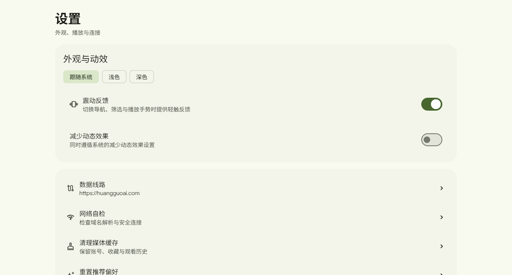
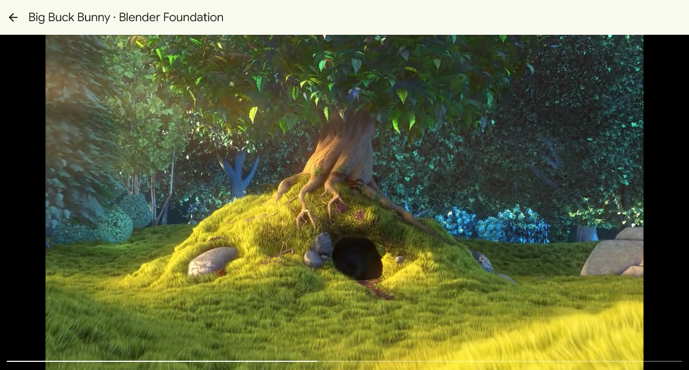

<p align="center"></p>

<h1 align="center">Hedone</h1>
<p align="center">A quiet interface. A carefully built playback pipeline.</p>
<p align="center"><a href="README.md">简体中文</a> · English</p>

Hedone is a Flutter and Rust client for Huangguo. Browsing, search, favorites, resume and episode navigation share one interface and media pipeline across Android, iOS, Windows, macOS and Linux. The web app runs against a same-origin Rust service.

The code is licensed under [PolyForm Noncommercial 1.0.0](LICENSE), for **noncommercial use only**. Advertising, paid unlocking, resale and commercial integration are not offered; the full license governs permitted use. Third-party content and dependencies retain their respective rights.

## In the app





These are actual Windows captures of the project running. The player shows the publicly licensed Blender Foundation film *Big Buck Bunny*, with no adult content. No generated posters, composited player frames or fabricated catalog entries are used. The film is documentation material, not a Huangguo catalog listing. See [capture instructions and attribution](docs/screenshots/README.md).

## Features

- Categories, rankings, search, details, episodes and community posts. Favorites and viewing history are isolated by upstream origin.
- HLS and progressive video, seeking, speed control, mute, resume and immersive episode navigation, with one player per playback page.
- GPU rendering and automatic hardware decoding on native platforms. Playback information reports the actual decoder; unsupported devices or formats can fall back to software. Browser acceleration remains browser-managed.
- Material 3 Expressive, light/dark themes, responsive navigation, reduced motion and bundled Chinese/Latin fonts.
- Rust handles authentication, DNS, TLS, encrypted covers, HLS rewriting and bounded media streaming. Native credentials use OS secure storage.
- Fixed routes, mirrors from the upstream publication page, content API probes, network diagnostics and optional logs.

The app plays media; it has no export or transcoding pipeline and therefore no video encoder. Requesting hardware decoding does not guarantee support for every device, codec or browser.

## Sources and connectivity

Hedone uses Huangguo's JSON API on the fixed origin `huangguoai.com` and temporary mirrors from the publication page. Adapters for 51 Chigua and Haijiao remain unverified.

Native users can probe and select routes in Settings. A successful probe checks the content API, not just a landing page. Discovered mirrors support guest browsing only and cannot receive passwords or account tokens. Web routes are configured by the service administrator.

If the publication page is unavailable, enter a current HTTPS mirror obtained from the official source using the manual route option. It probes content before switching. The latest route and playback checks are recorded in the [verification notes](docs/verification.md#2026-11-26-黄果线路与片源).

RecurseX 0.2.6 handles DNS, with Courierust 1.1.3 verifying DoH. Content uses Reqwest 0.13.5 / Rustls 0.23, retaining certificate validation, per-hop target checks, DNS pinning and credential isolation. DNS improvements cannot resolve IP/SNI blocking or an unavailable upstream. Proxy-free access across mainland China is not guaranteed. Actual results are recorded in [verification notes](docs/verification.md).

## Development

Project toolchain: Flutter 3.47.9 / Dart 3.13.7, Rust 1.99.1 and the SDK for your target platform.

```sh
flutter pub get --enforce-lockfile
flutter run -d windows
```

Flutter Native Assets builds and packages the Rust library. Use the appropriate device ID for other platforms. Desktop and Apple builds require their respective host systems. See [deployment](docs/deployment.md) for signing, web hosting and network configuration.

```powershell
# Formatting, analysis, Flutter/Rust regression tests and Clippy
./tool/check.ps1

# Rebuild platform icons from the single SVG source
./tool/generate-icons.ps1
```

On Linux/macOS, use `bash tool/check.sh`. Keep both `pubspec.lock` and `rust/Cargo.lock` committed.

## Layout

| Path | Responsibility |
| --- | --- |
| `lib/core/` | State, pagination, storage and playback lifecycle |
| `lib/data/` | Models, repository and native/web transport |
| `lib/features/`, `lib/ui/` | Screens, theme and shared interactions |
| `rust/src/` | Upstream protocol, sessions, network policy and media gateway |
| `hook/` | Native asset builds |
| `assets/brand.svg` | Single source of truth for the brand mark |
| `test/`, `integration_test/` | Unit, layout and native pipeline regressions |

[Architecture](docs/architecture.md) · [Dependencies](docs/dependencies.md) · [Security](docs/security.md) · [Performance](docs/performance.md) · [Recommendations](docs/recommendations.md) · [Verification](docs/verification.md)

Issues with reproduction steps, environment details and redacted logs, along with technical PRs, are welcome. The maintainers do not host content, are not affiliated with the upstream service and cannot guarantee third-party API availability. Do not include credentials, tokens or signed media URLs in reports.

Versions v1.0.1 and earlier were released under MIT; previously granted rights to those releases are not revoked. The current code is governed by [LICENSE](LICENSE). Fonts, dependencies and film screenshots keep their own licenses.
