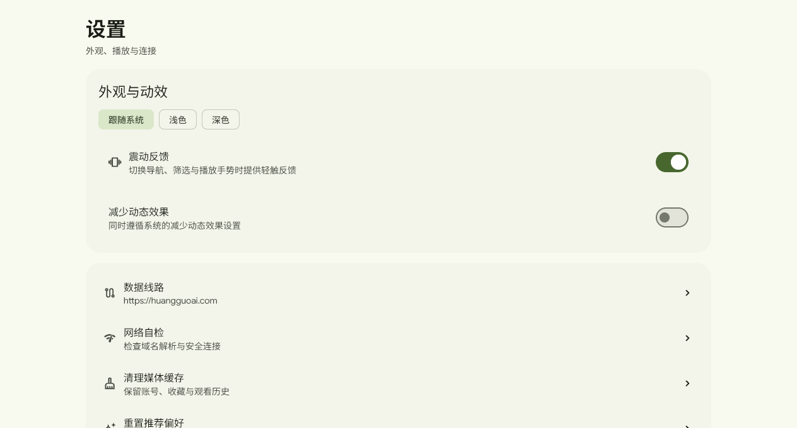
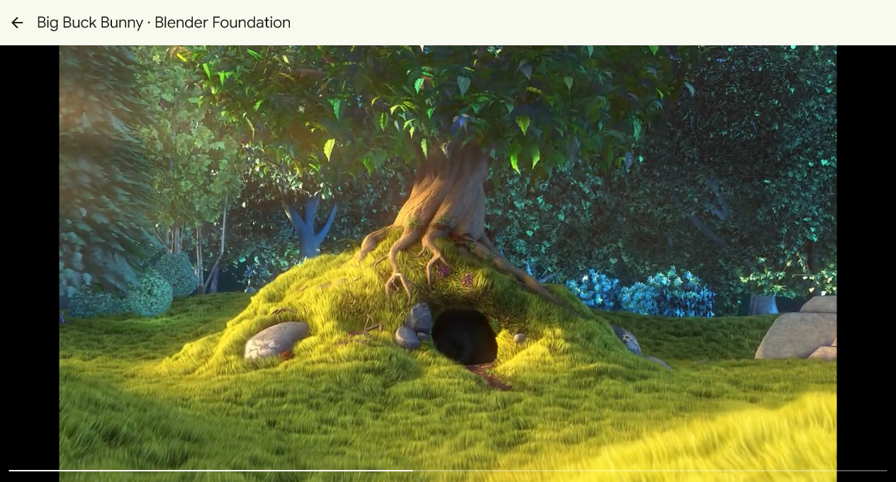

<p align="center"></p>

<h1 align="center">Hedone</h1>
<p align="center">轻盈的界面，扎实的播放链路。</p>
<p align="center">简体中文 · <a href="README.en.md">English</a></p>

Hedone 是基于 Flutter 与 Rust 的黄果客户端。浏览、搜索、收藏、续播和剧集切换共用一套界面与媒体管线，支持 Android、iOS、Windows、macOS、Linux；Web 由同源 Rust 服务提供。

代码采用 [PolyForm Noncommercial 1.0.0](LICENSE)，**仅限非商业用途**。不接受广告、付费解锁、销售或商业集成；授权范围以许可证全文为准。第三方内容与依赖保留各自权利。

## 看看实际界面





以上是 Windows 上运行项目代码的实际截图。播放画面来自 Blender Foundation 的公开短片 *Big Buck Bunny*，不含成人内容；没有生成海报、拼接播放器或伪造片库数据。短片只用于文档展示，不作为黄果片库内容。截图复现步骤与素材署名见[截图说明](docs/screenshots/README.md)。

## 能做什么

- 浏览分类、榜单、搜索结果和详情，查看剧集与社区内容；收藏与观看记录按线路隔离。
- HLS 与普通视频播放、拖动、倍速、静音、续播、沉浸式切集；每个播放页只维护一个播放器。
- 原生视频统一启用 GPU 渲染和硬件解码自动选择。“播放信息”显示实际解码器，设备不支持时允许软件回退。Web 由浏览器决定硬件加速。
- Material 3 Expressive、明暗主题、响应式导航、减少动态效果，以及随包提供的中英文字体。
- Rust 集中处理认证、DNS、TLS、图片解密、HLS 改写与有界流式传输；原生凭据使用系统安全存储。
- 固定线路与官方发布页镜像、内容 API 探测、网络自检和可选诊断日志。

应用只播放媒体，没有视频导出或转码流程，因此没有编码器。“请求硬件解码”并不意味着所有设备、格式和浏览器都支持 GPU 解码。

## 数据源与网络

当前实现的是黄果 edge 协议。51 吃瓜和海角没有实现可验证的适配器，不将一个站点的域名替换成另一个站点来冒充接入成功。

原生端可在“设置 → 数据线路”检测并选择可用线路。探测检查内容接口，首页能打开不等于能播放。镜像只供游客浏览，不能接收账号密码或令牌。Web 线路由服务管理员配置。

发布页打不开时，可通过“手动输入线路”填入从官方取得的最新 HTTPS 镜像，检测成功后再使用。本次已验证的临时镜像与测试条件见[验证说明](docs/verification.md#黄果可达性)，地址可能随时失效。

默认 DNS 使用 RecurseX 0.2.6，DoH 通过 Courierust 1.1.3 验证；内容传输使用 Reqwest 0.13.5 / Rustls 0.23。保留完整证书验证、逐跳目标校验、DNS 地址固定及凭据隔离。DNS 可以改善解析，不能解决 IP/SNI 阻断或上游停服；项目不承诺中国大陆全网免代理可用。本次直连结果记录在[验证说明](docs/verification.md)。

## 开发

当前工程工具链：Flutter 3.47.9 / Dart 3.13.7、Rust 1.99.1，以及目标平台 SDK。

```sh
flutter pub get --enforce-lockfile
flutter run -d windows
```

原生 Rust 库通过 Flutter Native Assets 构建和打包。其他平台使用对应 device ID；Windows、Linux 和 Apple 平台需要各自宿主环境。Android 签名、Web 部署及网络配置见[构建与部署](docs/deployment.md)。

```powershell
# 格式、静态检查、Flutter/Rust 回归与 Clippy
./tool/check.ps1

# 从唯一 SVG 源文件重建各平台图标
./tool/generate-icons.ps1
```

Linux/macOS 可运行 `bash tool/check.sh`。提交时保留 `pubspec.lock` 和 `rust/Cargo.lock`。

## 工程结构

| 路径 | 职责 |
| --- | --- |
| `lib/core/` | 状态、分页、存储与播放生命周期 |
| `lib/data/` | 模型、仓库和原生/Web 传输 |
| `lib/features/`、`lib/ui/` | 页面、主题与共享交互 |
| `rust/src/` | 业务协议、会话、网络策略与媒体网关 |
| `hook/` | 原生资源构建 |
| `assets/brand.svg` | 品牌图形的唯一源文件 |
| `test/`、`integration_test/` | 单元、布局与原生链路回归 |

[架构](docs/architecture.md) · [依赖边界](docs/dependencies.md) · [安全设计](docs/security.md) · [性能](docs/performance.md) · [推荐策略](docs/recommendations.md) · [验证记录](docs/verification.md)

欢迎带复现步骤、环境信息与脱敏日志的问题报告和技术 PR。维护者不运营内容服务，与上游站点没有官方隶属关系，也不承诺第三方接口持续可用。请勿在 issue 中提交密码、令牌或带签名的媒体地址。

历史 v1.0.1 及更早版本曾以 MIT 发布，已取得的相应授权不被后续换证撤回；当前代码以仓库 [LICENSE](LICENSE) 为准。字体、依赖和文档中的影片截图不受本项目许可证替代。
